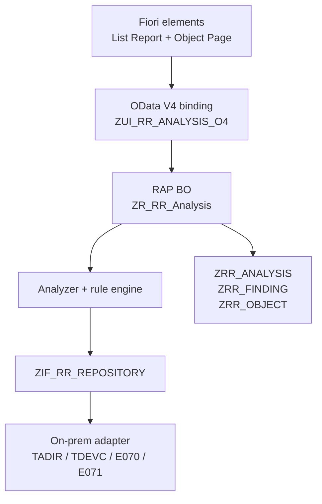

# RAPReady

RAPReady is an open-source SAP Fiori elements application that answers a deceptively difficult question before a release:

> Is this RAP package and its transport actually ready to move?

It turns repository and transport metadata into one persisted readiness analysis, a scored list of findings, and an auditable inventory of the objects that were checked. The application is implemented with the ABAP RESTful Application Programming Model (RAP), CDS view entities, an OData V4 service binding, and a metadata-driven Fiori elements List Report/Object Page.

The project is licensed under Apache-2.0.

## Why this exists

A RAP application rarely consists of one object. A production release can depend on CDS entities, behavior definitions, DCL, metadata extensions, service definitions, service bindings, behavior pools, tests, packages, and transport entries. Today, teams usually discover missing artifacts after an import, during service publication, or while manually reviewing a transport.

RAPReady makes those checks repeatable and visible to the whole delivery team. The first release deliberately stays read-only with respect to repository and transport content: it reports problems and suggested actions, but it never changes a transport, publishes a service, creates a role, or modifies an SAP object.

## What the MVP checks

| Rule | Check | Default severity |
| --- | --- | --- |
| RR001 | A package is supplied | Error |
| RR002 | The package is not `$TMP` | Error |
| RR003 | The package exists | Error |
| RR004 | The package contains repository objects | Error |
| RR005 | The optional transport exists | Error |
| RR006 | The optional transport is still modifiable | Warning |
| RR007 | Every scoped object is present in the selected transport | Error per object |
| RR008 | The package contains at least one CDS DDL source | Warning |
| RR009 | The package contains a behavior definition | Warning |
| RR010 | The package contains a service definition | Warning |
| RR011 | The package contains an OData service binding | Warning |
| RR012 | The package contains a DCL role | Warning |
| RR013 | The package contains a test class by naming convention | Info |
| RR014 | The package exceeds the 1000-object synchronous limit | Error |

The rules are intentionally conservative. They identify structural release gaps; they do not claim that business logic, authorization design, performance, or the service contract is correct. ATC, ABAP Unit, integration tests, and import tests remain release gates.

## User experience

The generated Fiori elements application provides:

- A List Report of previous analyses with package, transport, score, status, and finding counts.
- An Object Page with analysis summary, findings, and the complete scanned object inventory.
- **Analyze** and **Reset** RAP actions.
- Criticality colors for the overall result and for individual findings.
- Search and filters for package, transport, status, severity, object type, and object name.

No standalone SAPUI5 project is required for the MVP. The UI is generated from the OData V4 service and CDS metadata extensions and can be previewed directly from the service binding in ADT.

## Architecture

The repository scanner is isolated behind `ZIF_RR_REPOSITORY`. The delivered `ZCL_RR_REPO_ONPREM` implementation is intentionally a Tier-2 adapter because the classic repository and CTS tables are not released ABAP Cloud APIs. The rule engine and RAP service do not depend on those tables directly.

See [Architecture](docs/architecture.md) and [Rule reference](docs/rules.md) for details.

## Prerequisites

- SAP S/4HANA 2022 on-premise or a compatible ABAP Platform level with managed RAP, CDS view entities, and OData V4 service bindings.
- ADT/Eclipse suitable for the target SAP release.
- abapGit with support for DDLS, DDLX, BDEF, SRVD, and SRVB object types.
- Developer authorization to create and activate objects in a customer package.
- Authorization to read repository and transport metadata.
- A role containing authorization object `Z_RAPREADY`, restricted by package (`DEVCLASS`) and activity (`ACTVT`).

Compatibility must be verified against the exact installed SAP_BASIS/S4CORE support package. The repository cannot run an ADT syntax check or publish a service binding without access to the target SAP system.

## Installation with abapGit

1. In the target development system, create or choose a parent package for the project, for example `ZRAPREADY`.
2. Open abapGit and create an **online repository** for `https://github.com/jathin11/RAPReady`.
3. Select the target package and pull the repository.
4. Activate in the dependency order below. If abapGit activates automatically, still run a package-wide activation afterward.
5. Open service binding `ZUI_RR_ANALYSIS_O4` in ADT and choose **Publish**.
6. Select the `Analysis` entity set and choose **Preview** to start the Fiori elements app.
7. Create an analysis, enter a package and optional transport, save, and choose **Analyze**.

Detailed setup, troubleshooting, launchpad configuration, and uninstall guidance are in [Setup and operation](docs/setup.md).

## Activation order

1. Root package, generated adapter subpackage, and tables `ZRR_ANALYSIS`, `ZRR_FINDING`, `ZRR_OBJECT`.
2. Authorization class `ZRRP` and object `Z_RAPREADY`.
3. Interfaces `ZIF_RR_TYPES`, `ZIF_RR_REPOSITORY`, `ZIF_RR_RULE`.
4. Classes `ZCL_RR_REPO_ONPREM`, `ZCL_RR_RULE_BASELINE`, `ZCL_RR_ANALYZER`, `ZCL_RR_RESULT_CALCULATOR`.
5. Interface CDS entities `ZR_RR_ANALYSIS`, `ZR_RR_FINDING`, `ZR_RR_OBJECT` and their DCL roles.
6. Behavior definition `ZR_RR_ANALYSIS` and behavior pool `ZBP_R_RR_ANALYSIS`.
7. Projection CDS entities, inherited projection DCL roles, and projection behavior `ZC_RR_ANALYSIS`.
8. Metadata extensions.
9. Service definition `ZUI_RR_ANALYSIS` and binding `ZUI_RR_ANALYSIS_O4`.
10. Package-wide syntax/activation check, ABAP Unit, ATC, service publication, and preview.

## Object inventory

| Layer | Objects |
| --- | --- |
| Persistence | `ZRR_ANALYSIS`, `ZRR_FINDING`, `ZRR_OBJECT` |
| Domain contracts | `ZIF_RR_TYPES`, `ZIF_RR_REPOSITORY`, `ZIF_RR_RULE` |
| Application services | `ZCL_RR_ANALYZER`, `ZCL_RR_RULE_BASELINE`, `ZCL_RR_RESULT_CALCULATOR` |
| Classic adapter subpackage | `ZCL_RR_REPO_ONPREM` |
| Authorization | `ZRRP`, `Z_RAPREADY` |
| RAP interface | `ZR_RR_ANALYSIS`, `ZR_RR_FINDING`, `ZR_RR_OBJECT`, `ZR_RR_ANALYSIS` behavior |
| RAP projection | `ZC_RR_ANALYSIS`, `ZC_RR_FINDING`, `ZC_RR_OBJECT`, projection behavior |
| UI | Three CDS metadata extensions |
| Service | `ZUI_RR_ANALYSIS`, `ZUI_RR_ANALYSIS_O4` |

## Security model

- Interface and transactional projection DCL limit analyses and child data to the creating user by default.
- RAP global and instance authorization checks use `Z_RAPREADY`; instance checks evaluate the actual package.
- Package and transport inputs become read-only after analysis. Use **Reset** before changing scope, which prevents a persisted result from describing a different scope.
- The application reads repository and CTS metadata only. It never writes to `TADIR`, `TDEVC`, `E070`, or `E071`.
- Service publication, launchpad catalogs, spaces/pages, business roles, and ICF/Gateway configuration are administrative steps and are not silently created by this repository.
- For team-wide analyses, replace the owner-only DCL with a governed project/organization predicate while retaining behavior authorization.

## Quality gates

Before promoting the package:

1. Run a package-wide ADT activation and syntax check.
2. Run all ABAP Unit tests, including the baseline rule tests.
3. Run ATC with your S/4HANA readiness, security, performance, and Clean Core variants.
4. Review every direct classic dependency in `ZCL_RR_REPO_ONPREM` as a governed Tier-2 exception.
5. Exercise create, update, delete, Analyze, Reset, owner isolation, paging, filtering, and OData error handling.
6. Verify a representative package with no transport, a modifiable transport, a released transport, and a deliberately incomplete transport.

The target is at least 80% meaningful ABAP Unit coverage of the rule and orchestration decisions. Coverage must be measured in the target system; this repository does not publish an unverified coverage badge. Record all evidence in the [production-readiness gate](docs/production-readiness.md).

## Extending RAPReady

- Implement `ZIF_RR_RULE` for a new rule.
- Register it in `ZCL_RR_ANALYZER=>CREATE_DEFAULT`.
- Keep repository access behind `ZIF_RR_REPOSITORY`.
- Add a stable rule ID and documentation in `docs/rules.md`.
- Add positive and negative ABAP Unit tests.
- Do not add automatic transport changes, service publication, role maintenance, or repository writes to a rule.

Good next rules include dependency-graph traversal, released-API checks, inactive-object detection through a supported API, ATC result ingestion, OData metadata contract diffing, draft completeness, and target-system operational prerequisites.

## Current limitations

- Package membership and transport completeness are checked at repository-object level; include-level or generated-object dependencies may require additional adapters.
- The baseline rule identifies test classes by naming convention because test includes are not represented as independent TADIR objects.
- ATC and ABAP Unit execution are not invoked by the RAP LUW. They belong in CI/CD or an application-job integration.
- The adapter uses classic SAP repository/CTS tables and therefore is not ABAP Cloud Tier 1.
- Interactive scans are limited to 1000 objects. A larger package receives blocking finding `RR014`; no partial snapshot can be READY.
- Service binding publication and launchpad content must be completed in the target system.

## Roadmap

- Pluggable rule discovery through customizing or a released configuration BO.
- ATC run/result adapter and Azure DevOps quality-gate endpoint.
- Dependency graph with package interfaces and released API classification.
- OData V4 metadata snapshot and breaking-change detection.
- Waiver workflow with approver separation, expiry, and audit trail.
- Multi-system comparison for development, quality, and production readiness.

## Contributing

Issues and pull requests are welcome. Read [CONTRIBUTING.md](CONTRIBUTING.md) before contributing. Please keep the core read-only, add tests for every rule, and document release-sensitive dependencies.

## License

Copyright contributors. Licensed under the [Apache License 2.0](LICENSE).
