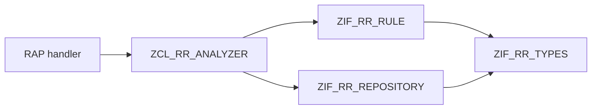

# Architecture

## Deployment choice

RAPReady is an on-stack, non-draft, managed RAP application. On-stack placement keeps the metadata scan close to the ABAP repository and CTS data. Managed RAP owns the custom analysis persistence, locking, ETags, numbering, and transactional save. Draft is deliberately omitted because an analysis has only two small input fields and no long-running collaborative edit journey.

The service contract is OData V4. The UI contract uses projection entities, so persistence and interface entities are not exposed directly.

## Business object

| Entity | Ownership | Mutability through UI | Purpose |
| --- | --- | --- | --- |
| Analysis | Root | Create, update input, delete; Analyze and Reset actions | Scope, lifecycle, score, totals |
| Finding | Composition child | Read-only | Stable rule result and remediation |
| ScannedObject | Composition child | Read-only | Auditable object/transport inventory |

Children are created and deleted only by root actions using EML in local mode. The handler does not issue `COMMIT WORK`; the RAP transaction manager owns the LUW.

## Dependency direction

`ZCL_RR_REPO_ONPREM` is the only delivered class allowed to select from `TADIR`, `TDEVC`, `E070`, and `E071`. It is physically isolated in the adapter subpackage generated from `src/adapter`. This is a governed Tier-2 boundary. A future released-API or remote adapter can implement the same interface.

## Transaction and concurrency

- Root UUIDs and child UUIDs use managed numbering.
- Root updates use `LOCAL_LAST_CHANGED_AT` as ETag.
- Analyze replaces the existing child snapshot inside the current RAP transaction.
- Analyze is disabled while status is `RUNNING`.
- Scope package and transport are read-only after analysis until Reset returns the record to `NEW`.
- Failures are reported through RAP messages; no partial result is committed by the application.

## Authorization

CDS DCL applies owner isolation to the root and both directly queryable child entities. Each transactional projection has an explicit DCL that inherits its interface-entity conditions. RAP global authorization uses `Z_RAPREADY` for operation-level checks, and instance authorization checks the actual `DEVCLASS` for change, delete, Analyze, and Reset.

For a shared team deployment, replace owner isolation with a governed team predicate only after designing the read-access model. Update both interface/projection DCL and behavior authorization together.

## Performance

The adapter uses set-based selects for the package object list and selected transport entries, then performs hashed-table membership checks in ABAP. Child table keys start with client and analysis UUID, making composition navigation selective. Interactive scans persist at most 1000 objects; the separate count detects a larger scope and produces blocking finding `RR014`. Larger scopes require chunked application-job execution.
