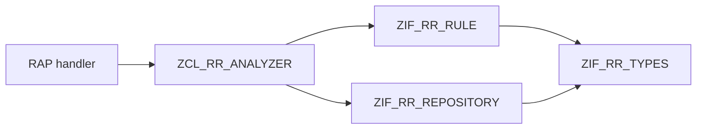

# Architecture

## Deployment choice

RAPReady is an on-stack, non-draft, managed RAP application. On-stack placement keeps the metadata scan close to the ABAP repository and CTS data. Managed RAP owns the custom analysis persistence, locking, ETags, numbering, and transactional save. Draft is deliberately omitted because an analysis has only two small input fields and no long-running collaborative edit journey.

The service contract is OData V4. The UI contract uses projection entities, so persistence and interface entities are not exposed directly.

## Business object

| Entity | Ownership | Mutability through UI | Purpose |
| --- | --- | --- | --- |
| Analysis | Root | Create, update input, delete; Analyze and Reset actions | Scope, lifecycle, score, totals |
| Finding | Composition child | Read-only | Stable rule result and remediation |
| ScannedObject | Composition child | Read-only | Auditable object/transport inventory |

Children are created and deleted only by root actions using EML in local mode. The handler does not issue `COMMIT WORK`; the RAP transaction manager owns the LUW.

## Dependency direction

`ZCL_RR_REPO_ONPREM` is the only delivered class allowed to select from `TADIR`, `TDEVC`, `E070`, and `E071`. This is a governed Tier-2 boundary. A future released-API or remote adapter can implement the same interface.

## Transaction and concurrency

- Root UUIDs and child UUIDs use managed numbering.
- Root updates use `LOCAL_LAST_CHANGED_AT` as ETag.
- Analyze replaces the existing child snapshot inside the current RAP transaction.
- Analyze is disabled while status is `RUNNING`.
- Failures are reported through RAP messages; no partial result is committed by the application.

## Authorization

CDS DCL applies owner isolation to the root and both directly queryable child entities. RAP global authorization checks `S_DEVELOP` for display or change activity. This baseline is appropriate for a developer tool but is not a substitute for a project-specific authorization concept.

For a shared team deployment, introduce a dedicated authorization object with at least analysis scope, package pattern, display, execute, and administration activities. Update both DCL and behavior authorization together.

## Performance

The adapter uses set-based selects for the package object list and selected transport entries, then performs hashed-table membership checks in ABAP. Child table keys start with client and analysis UUID, making composition navigation selective. Very large packages should be tested with realistic volumes; a future version can add an object cap and application-job execution.
